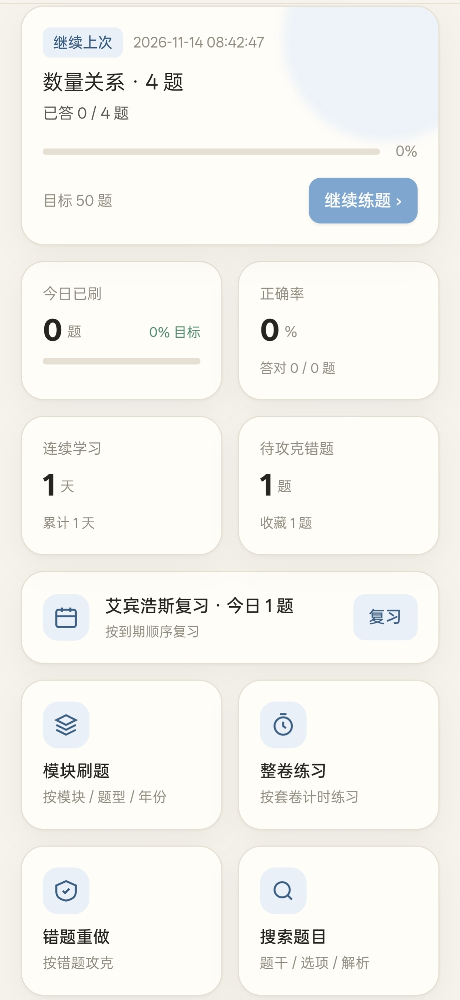
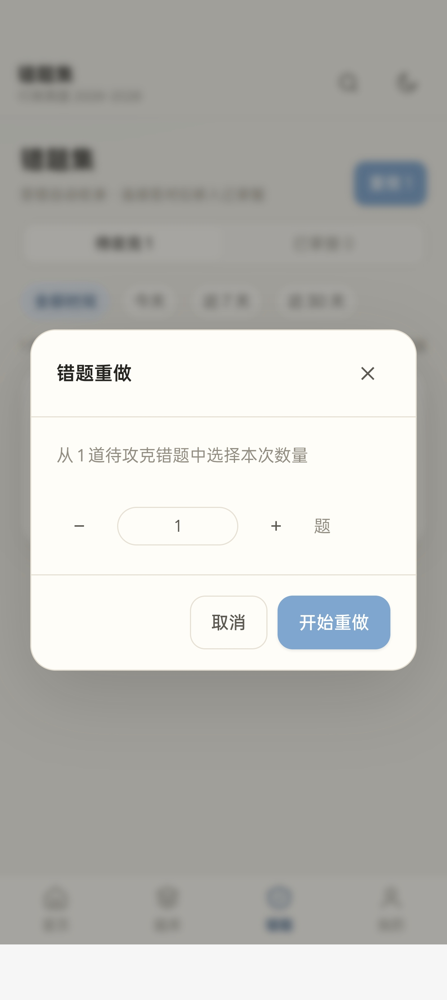
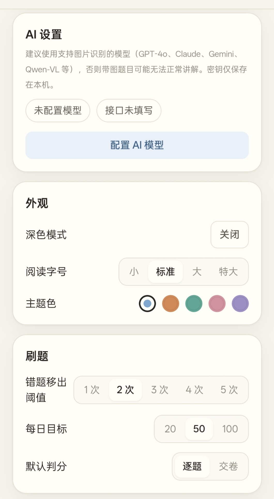
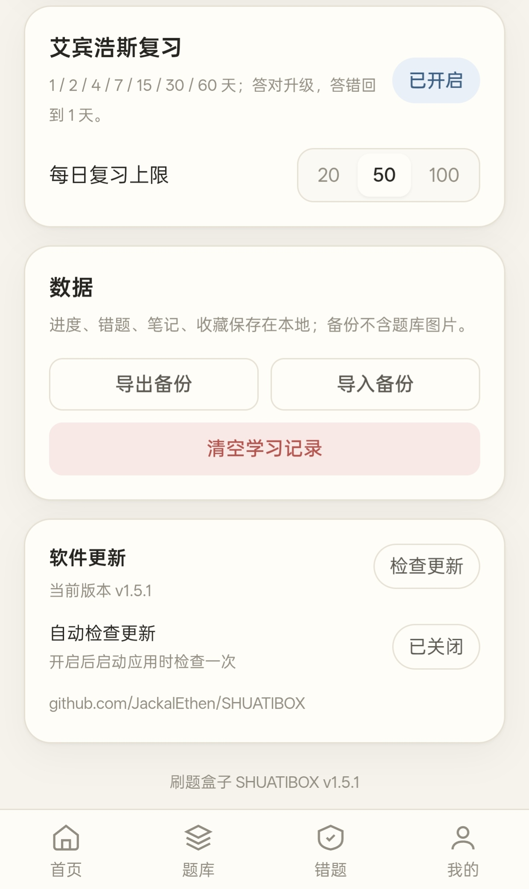

<h1 align="center">SHUATIBOX</h1>

<p align="center">
  <b>A local-first, offline practice app</b><br>
  Windows / Android · no server · no account · bring your own question banks
</p>

<p align="center">
  
  
  
  
  
</p>

<p align="center">
  
  
  
  
  
  
</p>

<p align="center">
  <a href="README.md">中文</a> · <b>English</b>
</p>

---

## Screenshots

**Windows**

  

**Android**

    

## Features

- Practice modes: random, full paper, mock exam, custom set, wrong-question retry, favorites
- Practice setup: choose 1–500 questions per module session (default 20) and optionally mix in about 25% of pending wrong questions from the same module (rounded up, at least 1), most recent first
- Review: spaced repetition (1/2/4/7/15/30/60 days) with a configurable daily review limit
- Desktop sidebar: collapsible icon-only mode with remembered state
- Grading: instant per-question grading or grade after submission; single-choice, multi-choice, true/false, 2–8 options
- Study tools: wrong-question book (pending / mastered), favorites, notes
- Search: full text over stems, options, explanations, qid and paper titles, with material preview
- Statistics: daily volume, accuracy, weak question types, exam history
- Appearance: light/dark, 5 accent colors and 4 reading text sizes
- Bilingual UI: switch between Chinese and English in Settings; defaults to the system language. AI explanations and import messages follow the UI language
- Bank management: import and switch between multiple question banks; imports can append to the current bank, an existing bank, or a new bank, existing papers are skipped (never overwritten), and the import report lists invalid questions and missing images
- AI explanations: explain the current question from the practice page, including material, stem, options and reference answer; multi-turn follow-ups, image questions, cancel anytime, Markdown answers
- AI settings: configure an OpenAI-compatible endpoint with automatic connectivity and vision checks after saving; AI conversion import normalizes non-conforming Markdown into the bank format with chunked conversion, per-file isolation, a conversion report and selectable target bank
- In-place editing: fix a stem, option, answer or explanation while practicing; changes are written back to the local bank and reflected in the wrong book and search
- Updates: automatic or manual GitHub release checks; a prompt appears for new versions, mirrors are used when GitHub is unreachable, and Android downloads the APK to Downloads with an install notification
- Mobile: Android status-bar and navigation-bar safe areas, improved dialogs and font sizes
- Backup: export / import study records (question images excluded)

## Tech Stack

| Layer | Technology |
| --- | --- |
| Shell | Tauri 2 |
| Frontend | React 19 + TypeScript + Vite + Tailwind CSS |
| Rendering | marked + DOMPurify |
| Backend | Rust + rusqlite (SQLite) + zip + sha2 + reqwest |
| Platforms | Windows, Android |

## Quick Start

Requirements: Node.js 20+, Rust 1.88+; WebView2 runtime on Windows.

```bash
npm install
npm run tauri dev      # development
npm run tauri build    # build installers
```

Android build (requires Android SDK, NDK and JDK 21):

```powershell
$env:ANDROID_HOME = "C:\path\to\Android\Sdk"
$env:NDK_HOME = "$env:ANDROID_HOME\ndk\<version>"
npm run tauri -- android build --debug --target aarch64 --apk
```

## Question Bank Format

Import a folder of Markdown files or a zip. Each `.md` file is one module of one paper, starting with frontmatter:

```markdown
---
Paper: "2023 National Exam (Verbal)"
Year: "2023"
Region: "National"
Module: "Verbal"
Exam Type: "National"
---

## Question 1 · Logic Fill

Stem text. Markdown, HTML and images are supported.

- **A**. Option one
- **B**. Option two
- **C**. Option three

**Answer**: B

**Explanation**

Explanation text.
```

Key rules:

- Option labels are `A`–`H`, must start at A and stay contiguous, 2–8 options
- Multiple answers: `A,C` (also accepts `A、C`, `A C`, `AC`)
- True/false questions may use a single `- (option) []` line; answer A = true, B = false
- Material questions use `## Material 1` followed by `### Question 1`
- Chinese aliases are also supported for frontmatter, headings, `**Answer**` and `**Explanation**`
- Images use relative paths, e.g. ``; supported: `png jpg jpeg jfif gif webp`
- Questions with a missing answer are still imported but are not graded
- `README.md` is skipped automatically

Folder example:

```text
bank/
  01-Verbal/
    2023-national.md
    90-images/
      q1.png
  02-Quantitative/
    2023-national.md
  README.md
```

The full format contract lives in [`import-format.md`](import-format.md).

## Data Location

| Environment | Path |
| --- | --- |
| Development | `data/` in the project root |
| Installed (Windows) | `%APPDATA%\com.shuatibox.app` |
| Android | App private storage |

Question bank databases and images live in that directory. Uninstalling the Windows app removes the question banks, images, study records, and settings from that directory.

## Project Layout

```text
src/                    Frontend (Desktop*.tsx and Mobile*.tsx UIs)
src-tauri/src/          Rust backend: commands / db / importer / models / saf
src-tauri/gen/android/  Android project and SAF native plugin
tools/import-parser/    Markdown parser and CLI import tools
import-format.md        Full import format contract
docs/                   Acceptance and design notes (local)
```

## Testing

```bash
npm run test:parser    # import parser
npm run test:grade     # grading logic
npx tsc --noEmit       # type check
cd src-tauri && cargo check
```

## License

[MIT](LICENSE)

## Notes

- No server, no account; update checks contact GitHub, and AI features require an endpoint you configure
- Append imports are identified by paper | year | region; existing papers are skipped and never overwritten
- Banks and images are stored locally; imported images are deduplicated by SHA-256
- The same question can appear in several papers; editing affects only the record in the current paper
- Editing cannot add new images; existing image references are preserved
