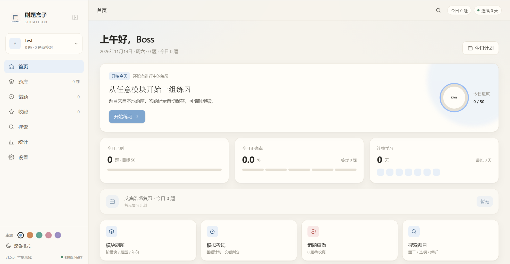
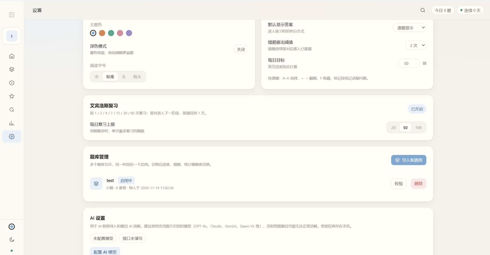
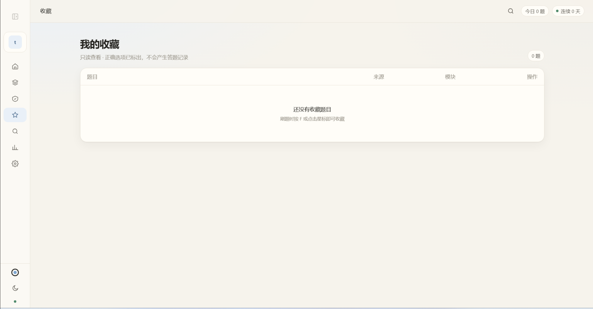
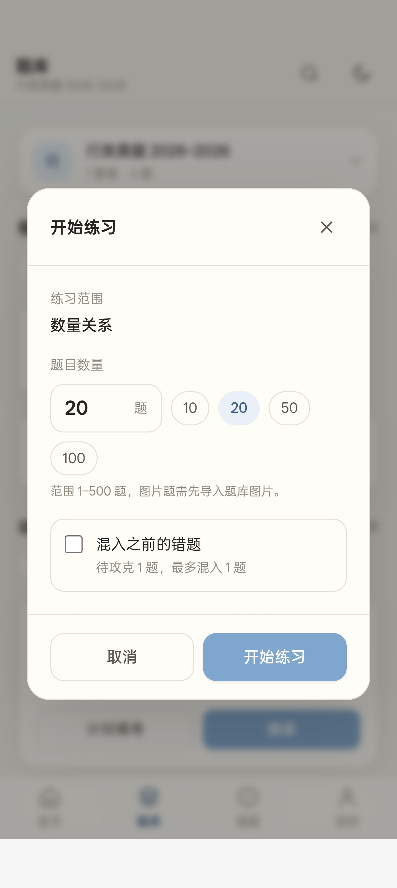

<h1 align="center">SHUATIBOX</h1>

<p align="center">
  <b>A local-first, offline practice app</b><br>
  Windows / Android · no server · no account · bring your own question banks
</p>

<p align="center">
  
  
  
  
  
</p>

<p align="center">
  <a href="README.md">中文</a> · <b>English</b>
</p>

---

## Screenshots

**Windows**

  

**Android**

    

## Features

- Practice modes: random, full paper, mock exam, custom set, wrong-question retry, favorites
- Grading: instant or after submission; single-choice, multi-choice, true/false
- Review: spaced repetition (1/2/4/7/15/30/60 days)
- Study tools: wrong-question book, favorites, notes, full-text search, statistics
- Bank management: import md/txt/html/docx files or zip/tar archives, multiple banks, movable storage
- Appearance: light/dark, 5 accent colors, fonts and text sizes, practice background (solid color / built-in / local image)
- Shortcuts: every practice shortcut is configurable; Android supports hardware keyboards
- Card practice: an always-on-top mini window from the practice page on Windows
- Markdown reader: desktop sidebar entry, Android "Me" entry; read and edit (Android read-only)
- AI: explanations, conversion import, update checks

## Tech Stack

| Layer | Technology |
| --- | --- |
| Shell | Tauri 2 |
| Frontend | React 19 + TypeScript + Vite + Tailwind CSS |
| Rendering | marked + DOMPurify |
| Markdown editing | @toast-ui/editor |
| Backend | Rust + rusqlite (SQLite) + zip + tar + sha2 + reqwest |
| Platforms | Windows, Android |

## Quick Start

Requirements: Node.js 20+, Rust 1.88+; WebView2 runtime on Windows.

```bash
npm install
npm run tauri dev      # development
npm run tauri build    # build installers
```

## Question Bank Format

Each `.md` file is one module, with frontmatter and Chinese/English headings:

```markdown
---
Paper: "2023 National Exam"
Year: "2023"
Module: "Verbal"
---

## Question 1

Stem text. Markdown, HTML and images are supported.

- **A**. Option one
- **B**. Option two

**Answer**: B

**Explanation**

Explanation text.
```

See [`import-format.md`](import-format.md) for the full contract.

## Data Location

| Environment | Path |
| --- | --- |
| Development | `data/` in the project root |
| Installed (Windows) | `%APPDATA%\com.shuatibox.app` (movable in Settings) |
| Android | App private storage (movable to `Android/data/com.shuatibox.app/files/banks`) |

## Testing

```bash
npm run test:parser    # import parser
npm run test:grade     # grading logic
npx tsc --noEmit       # type check
cd src-tauri && cargo test
```

## License

[MIT](LICENSE)
