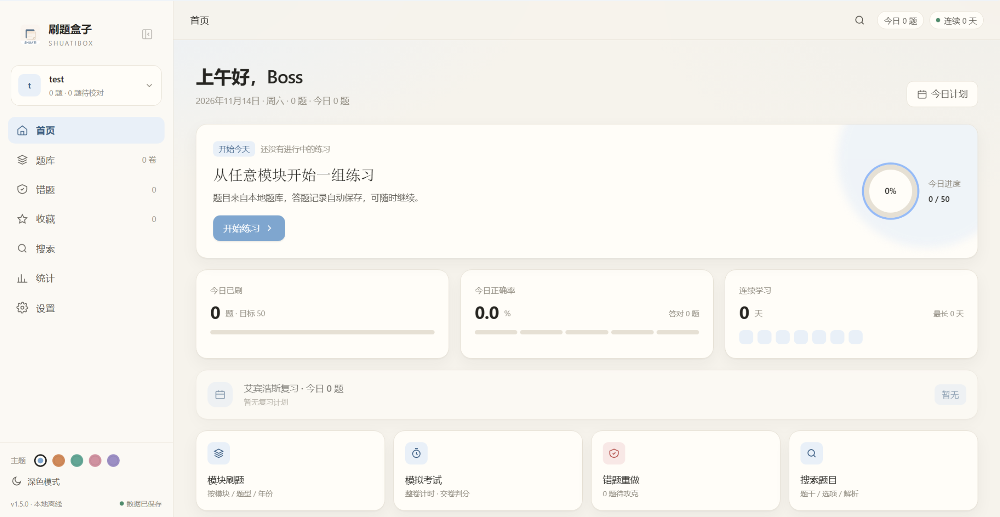
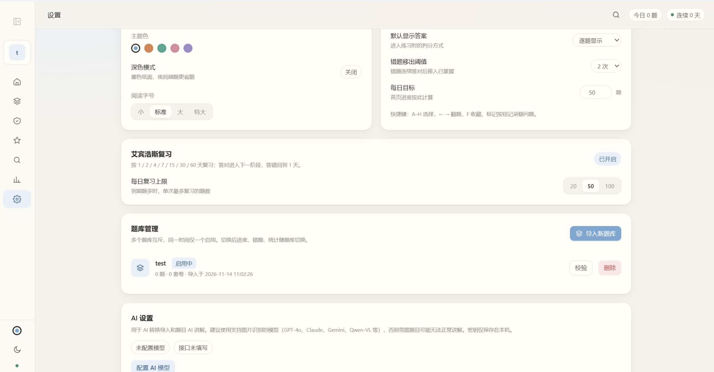
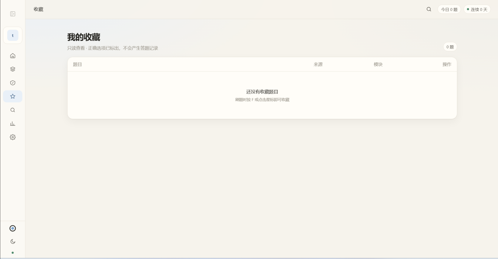
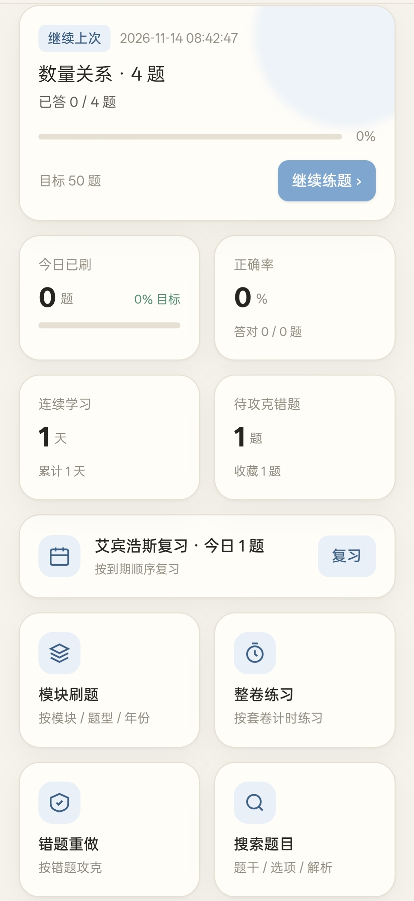
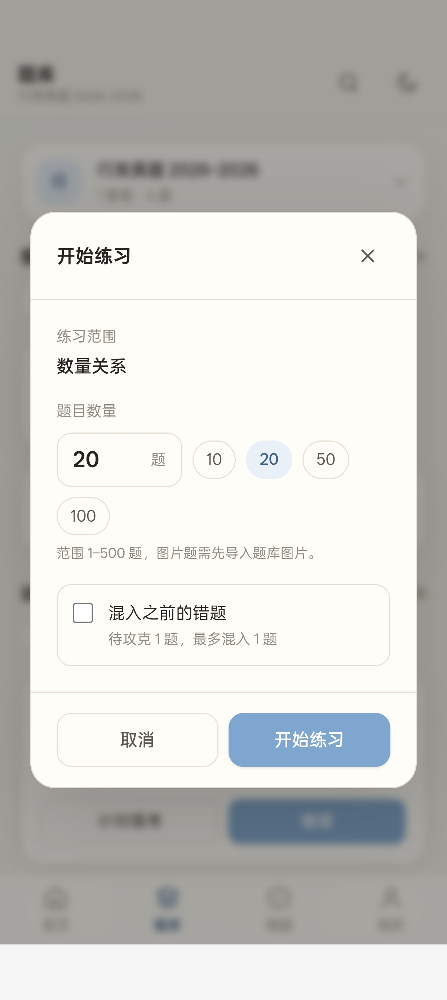
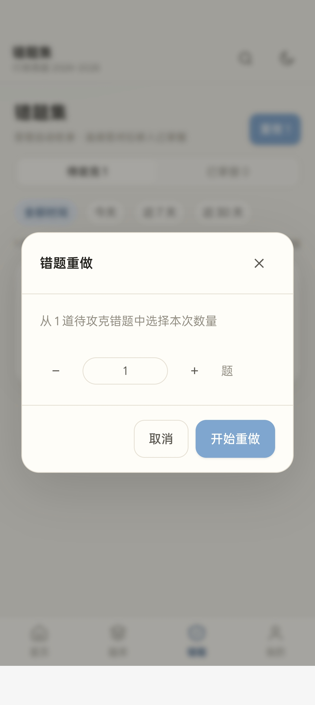
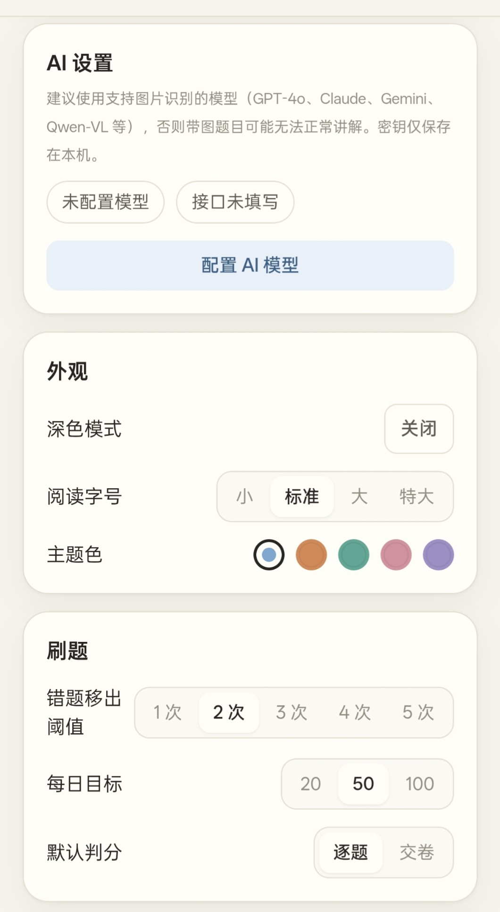
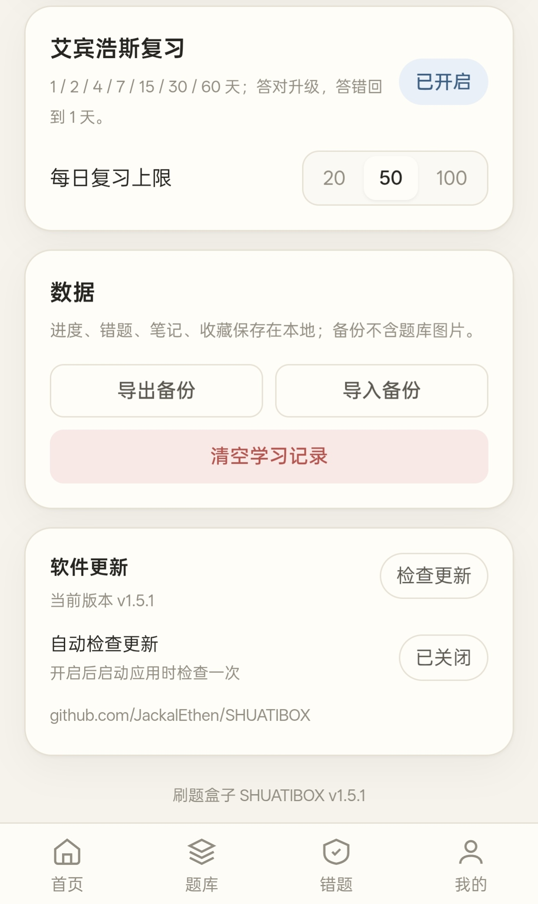

<h1 align="center">刷题盒子 SHUATIBOX</h1>

<p align="center">
  <b>本地优先的离线刷题应用</b><br>
  Windows / Android · 无需服务器 · 无需账号 · 自带题库
</p>

<p align="center">
  
  
  
  
  
</p>

<p align="center">
  <b>中文</b> · <a href="README-en.md">English</a>
</p>

---

## 界面预览

**Windows**

  

**Android**

    

## 功能

- 练习模式：随机、整卷、模考、自选题组、错题重做、收藏练习
- 判分：即时判分或交卷统一判分，支持单选、多选、判断
- 复习：艾宾浩斯间隔复习（1/2/4/7/15/30/60 天）
- 学习工具：错题本、收藏、笔记、全文搜索、统计
- 题库管理：导入 md/txt/html/docx 或 zip/tar 压缩包，支持多题库切换与目录迁移
- 外观：明暗主题、5 种主色、字体与字号、做题页背景（纯色 / 内置图 / 本地图片）
- 快捷键：做题页全部快捷键可自定义，Android 支持硬件键盘
- 卡片刷题：Windows 做题页可打开置顶迷你窗
- Markdown 阅读器：Windows 桌面侧栏、Android「我的」入口，支持阅读与编辑（Android 只读）
- AI：AI 讲解、AI 转换导入、更新检查

## 技术栈

| 层 | 技术 |
| --- | --- |
| 应用壳 | Tauri 2 |
| 前端 | React 19 + TypeScript + Vite + Tailwind CSS |
| 渲染 | marked + DOMPurify |
| Markdown 编辑 | @toast-ui/editor |
| 后端 | Rust + rusqlite (SQLite) + zip + tar + sha2 + reqwest |
| 平台 | Windows、Android |

## 快速开始

要求 Node.js 20+、Rust 1.88+，Windows 需 WebView2 运行时。

```bash
npm install
npm run tauri dev      # 开发模式
npm run tauri build    # 构建安装包
```

## 题库格式

每个 `.md` 文件是一个模块，支持 frontmatter 与中英文标题：

```markdown
---
试卷: "2023 年国考行测"
年份: "2023"
模块: "言语理解"
---

## 第 1 题 逻辑填空

题干文字，支持 Markdown、HTML 和图片。

- **A**. 选项一
- **B**. 选项二

**答案**：B

**官方解析**

解析内容。
```

完整格式约定见 [`import-format.md`](import-format.md)。

## 数据位置

| 环境 | 路径 |
| --- | --- |
| 开发 | 项目根目录 `data/` |
| Windows 安装版 | `%APPDATA%\com.shuatibox.app`（可在设置中迁移） |
| Android | 应用私有目录（可迁移到 `Android/data/com.shuatibox.app/files/banks`） |

## 测试

```bash
npm run test:parser    # 导入解析
npm run test:grade     # 判分逻辑
npx tsc --noEmit       # 类型检查
cd src-tauri && cargo test
```

## 许可证

[MIT](LICENSE)
