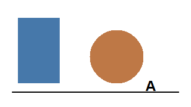
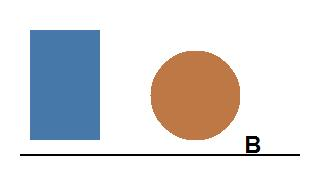

2018年联考《行政职业能力测验》真题精选（图形推理与资料分析）

一、图形推理

6. 从所给的四个选项中，选择最合适的一个填入问号处，使之呈现一定的规律性。（　　）

A．顺时针旋转90度　B．逆时针旋转90度　C．水平翻转　D．垂直翻转

【答案】B

【解析】题干图形依次逆时针旋转90度，故选B。

7. 请根据下图判断，该立体图形的俯视图是（　　）

A、甲
B、乙
C、丙
D、丁

【答案】C

【解析】俯视图从上往下看，可见轮廓为丙图所示。

8. （多选）根据材料，下列说法正确的有（　　）

①该国2020年GDP增速为正
②该国2021年GDP增速高于2020年
③该国2022年GDP增速低于2021年
④该国2023年GDP增速为负

A. ①②
B. ②③
C. ①④
D. ③④

【答案】A

【解析】由表中数据可知，①正确，④错误；②③无法从材料推出，故选A。

9. 根据下表，该地区GDP增速最高的年份是（　　）

| 年份 | GDP增速 |
|---|---|
| 2020年 | 2.3% |
| 2021年 | 8.1% |
| 2022年 | 3.0% |
| 2023年 | 5.2% |

A. 2020年
B. 2021年
C. 2022年
D. 2023年

【答案】B

【解析】2021年GDP增速为8.1%，为表中最高。

材料二：

下图为某市近五年常住人口变化情况。

根据材料，回答下列问题。

（1）该市常住人口最多的年份是（　　）

A. 2019年
B. 2020年
C. 2021年
D. 2022年

【答案】C

【解析】图中2021年常住人口柱最高。

（2）该市人口变化趋势说明（　　）

A. 人口持续流出
B. 人口持续流入
C. 人口先增后减
D. 人口先减后增

【答案】B

【解析】五年间常住人口总体上升，说明人口持续流入。
